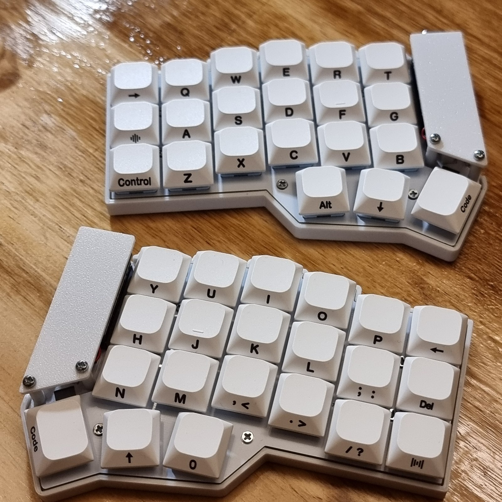
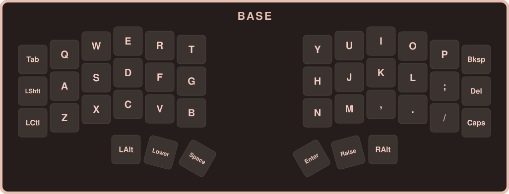
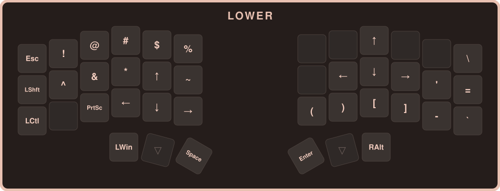
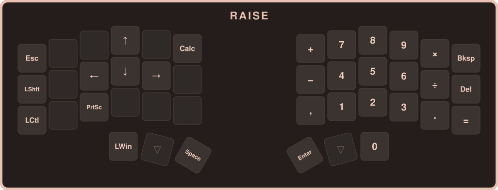
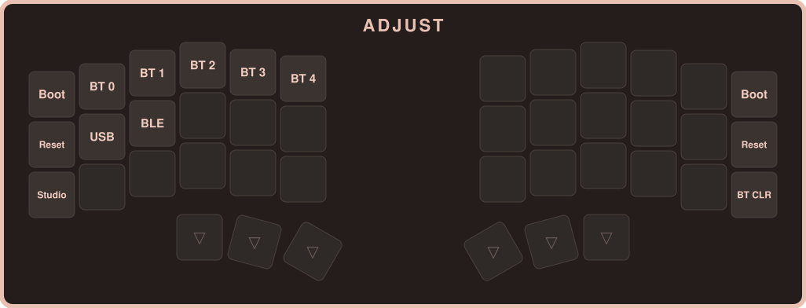

<p align="center">
  
</p>

<h1 align="center">Wireless HotSwap MX Ergo Split Corne Keyboard</h1>

Firmware [ZMK](https://zmk.dev) para un Corne inalámbrico con nice!nano v2 y nice!view. Pensado para el layout de teclado **Estados Unidos - Internacional** del sistema operativo (la ñ y los tildes se escriben con RAlt).

El keymap está en [config/corne.keymap](config/corne.keymap).

### Layer previews

#### Base


#### Lower (mantener Lower)


#### Raise (mantener Raise)


#### Adjust (mantener Lower + Raise)


- **BT 0 a BT 4**: elige el perfil Bluetooth. Se guardan hasta 5 dispositivos.
- **USB / BLE**: fuerza la salida por cable o por Bluetooth, aunque el teclado esté enchufado. El cable va en la mitad **izquierda**.
- **BT CLR**: borra el emparejamiento del perfil activo. Está lejos de los perfiles para no apretarlo por error.
- **Boot / Reset**: afectan solo a la mitad donde se aprietan, por eso están en las dos. Boot deja esa mitad lista para flashear.
- **Studio**: desbloquea [ZMK Studio](https://zmk.studio), habilitado en la mitad izquierda.

### Perfiles Bluetooth

| Perfil | Dispositivo |
|---|---|
| BT 0 | PC 1 |
| BT 1 | PC 2 |
| BT 2 | PC 3 |
| USB | PC sin BT |

### Flashear

El firmware se compila con GitHub Actions en cada push (pestaña Actions, artifact `firmware`). Para cambios de keymap alcanza con flashear `corne_left`. La mitad derecha solo se reflashea si cambia algo de su propio firmware.

### Regenerar las imágenes de las capas

Si cambias el keymap, edita las capas en [docs/generate_layers.py](docs/generate_layers.py) y corre:

```
python docs/generate_layers.py
```
